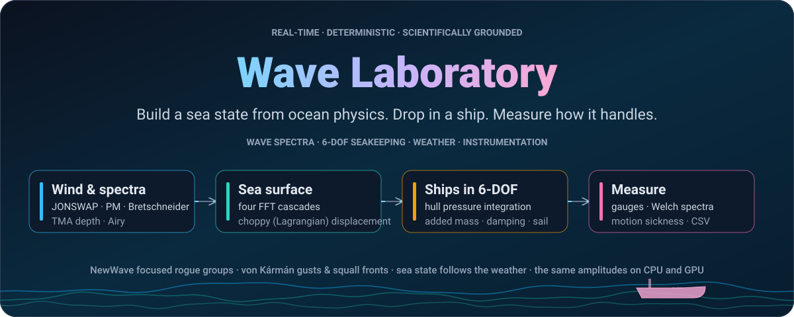
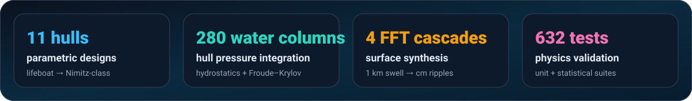
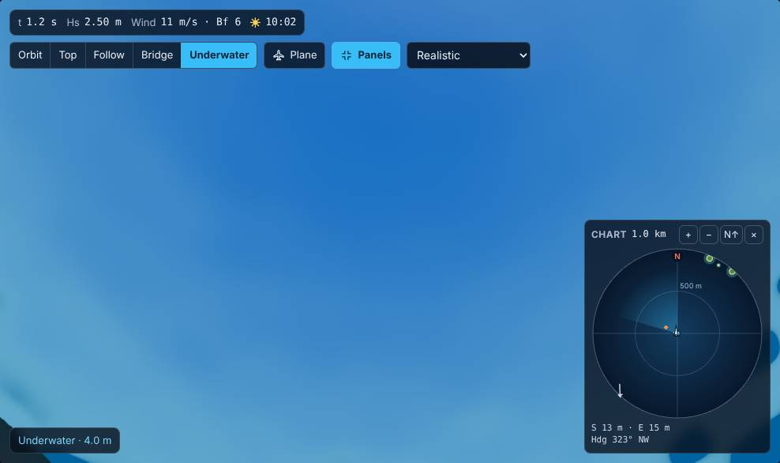
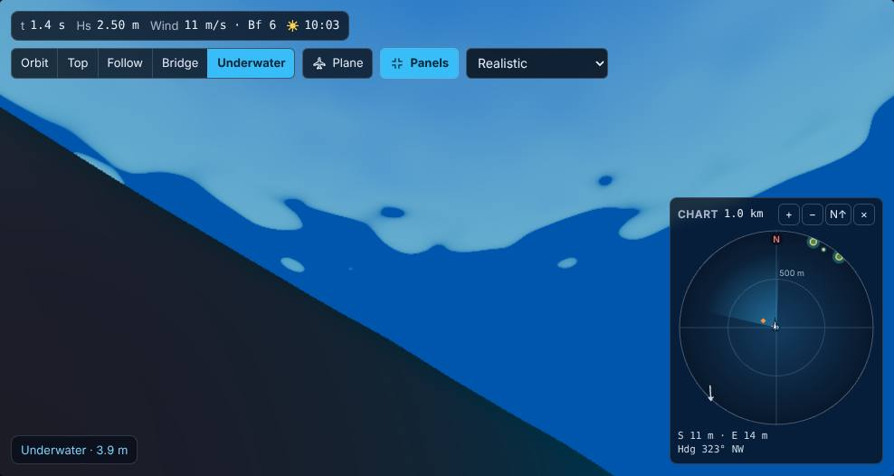
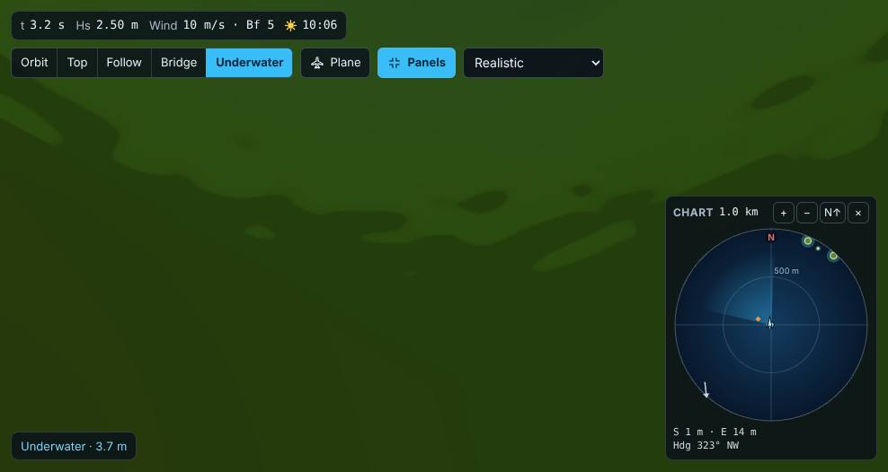

<div align="center">

<picture>
  <source media="(max-width: 640px)" srcset="docs/assets/readme/hero-mobile.svg"/>
  
</picture>

# Wave Laboratory

[](tsconfig.json)
[](src/render)
[](docs/PLAN.md)

[](src/)
[](https://exios66.github.io/wave-laboratory/)
[](src/ui)
[](package.json)
[](LICENSE)

**[Live demo](https://exios66.github.io/wave-laboratory/)** · **[Quickstart](#quickstart)** · **[The physics](#the-physics)** · **[Using the lab](#using-the-lab)** · **[Project layout](#project-layout)** · **[Docs](#documentation)**

</div>

---

## What this does

A real-time, scientifically grounded **3D ocean-wave sandbox** — and a working
seakeeping laboratory. Build a sea state from oceanographic wave spectra, drop
ships into it, and measure how they handle the waves with lab-grade
instruments. Every experiment is **deterministic**: the same experiment file
always produces the same sea, the same weather and the same ship response.

<div align="center">

</div>

It runs entirely in your browser: a React 19 UI, a fixed-step physics kernel in
a Web Worker, and a Three.js/WebGL 2 renderer — no server, no install step
beyond `pnpm install`. The unit suite covers dispersion, spectra, hydrostatics,
flooding and mooring physics; a longer statistical validation suite checks the
simulator's distribution-level behaviour.

## The physics

<details open>
<summary><b>Waves — five spectral families</b></summary>

JONSWAP, Pierson–Moskowitz and Bretschneider spectra, the TMA finite-depth
correction, fetch-limited wind seas (Hasselmann et al. 1973) and regular Airy
waves. Directional spreading is Mitsuyasu, cos-2s or Donelan–Banner. A uniform
surface current Doppler-shifts the whole sea and sets the ships. The dispersion
relation includes finite depth and surface tension. The surface is synthesised
from four FFT cascades (1 km swells down to centimetre ripples) with choppy
(Lagrangian) displacement.

</details>

<details>
<summary><b>Rogue waves — NewWave focused groups</b></summary>

A NewWave focused group (Tromans et al. 1991) can raise a Draupner-class crest
at a chosen place and time inside any sea.

</details>

<details>
<summary><b>Weather — from calm to hurricane</b></summary>

Gusts drawn from the von Kármán turbulence spectrum and carried downwind as
moving patches; squall fronts with a wind jump, veer and downpour; rain, cloud,
fog and lightning. A wind sea can follow the weather so the sea builds and
turns with the wind, and whitecap coverage follows Monahan's law. One-click
situations go from calm to hurricane.

</details>

<details open>
<summary><b>Ships — 6-DOF rigid bodies</b></summary>

Forces come from pressure integration over the instantaneous wetted hull
(hydrostatics + Froude–Krylov), sampled on up to 280 water columns, plus added
mass, radiation and viscous damping, propulsion, rudder and autopilot. Wind
acts on every hull through its frontal and side areas, and the square-rigged
pirate ship sails on the wind alone, bracing and reefing as the wind changes.

The **11-hull parametric library** runs from an 8.5 m SOLAS lifeboat and a
15 m power catamaran (two demihulls and a bridge deck lofted as one closed
mesh — very high GM/B, righting arm peaking near 20° heel as the weather hull
lifts clear) to a 330 m VLCC oil tanker and a 333 m Nimitz-class aircraft
carrier, with the analytic box barge and Wigley-I hull as validation targets,
a feeder container ship, a stern trawler, a patrol boat and a cruising sloop.

Slamming, green water and capsize are detected; a collision or heavy slam can
breach a watertight compartment that floods through the hole, costing
stability (free surface) and eventually sinking the ship. A ship can drop
anchor (or start moored to a buoy): an elastic catenary chain pulls at the
bow, she weathervanes into the wind, and the anchor drags if the load beats
its holding. The hull you see is lofted more finely than the physics mesh,
with antifouling below the waterline, deck cargo and a foam wake that does not
feed back into the forces. A loading setting (light ballast to overloaded)
sets the displacement, and the ship floats at the matching draft.

</details>

## Highlights

### What you see is what the ships feel

The GPU renderer inverse-FFTs the **same h₀ amplitudes the CPU physics uses**.
On each new sea it compares a texel with the CPU transform and logs an error
if they disagree; the browser tests fail when that error appears. The
instruments then prove the response: wave gauges, vessel motion recorders,
Welch spectra, zero-crossing statistics, motion-sickness incidence and CSV
export.

<details>
<summary><b>Underwater view — Snell's window, depth-graded light</b></summary>

| | |
|---|---|
|  |  |
|  |  |

The Underwater camera hangs a few metres below the surface (scroll to change
the depth, drag up to look into Snell's window) and works with or without
vessels. Any camera that dips below the waves switches to the underwater look
automatically, with a live depth badge. Light fades per colour with depth
following the water type's K_d (red first in clear water, blue first in
turbid coastal water); from below, the surface shows the rippled sky inside
the 48.6° window and a mirror outside it, and hulls are seen from beneath.

</details>

<details>
<summary><b>View, post-processing and overlays</b></summary>

Orbit, top, follow, bridge and underwater cameras. Drag to orbit and scroll or
pinch to zoom. Overlays colour the surface by elevation, slope, or breaking and
foam. Settings → Post-processing switches on bloom (sun, sun glint, lightning),
film grain and a vignette. They draw through an HDR target with ACES tone
mapping applied once at the end; bloom is automatic on medium quality and
above, but off on phones and software rendering.

</details>

<details>
<summary><b>World — a seeded seascape</b></summary>

A seeded, deterministic seascape that never disturbs the physics: island
chains and lighthouses, working fishing fleets (trawlers hauling nets),
merchant lanes with liners, cargo ships and tankers, patrol boats, offshore
oil rigs burning a flare, wind farms and buoys, plus seabed, kelp, coral,
wrecks and marine snow when you dive. Everything is deterministic from the
world seed and throttled to 4–12 hulls by device tier. Opt in under
Settings → Scenery to a pirate lugger that shadows you and a low recon pass.
See [`docs/AMBIENCE.md`](docs/AMBIENCE.md).

</details>

<details>
<summary><b>Phones and accessibility</b></summary>

The 3D view fills the top half in portrait (side by side in landscape). A
Scene / Inspector / Data switcher shows one panel at a time; the header keeps
Presets and a More menu for the rest. Touch targets are at least 44 px, except
the camera controls drawn on top of the view, which stay shorter so they do
not cover the sea.

Keyboard operable throughout, screen-reader labelled, WCAG 2.2 AA contrast,
light and dark themes, reduced-motion aware. Accessibility is checked with
axe on desktop and phone-sized viewports.

</details>

## Quickstart

> [!NOTE]
> **Verified locally:** the suite runs `632 passed (70 files)` on Node 22 with
> `pnpm`; `pnpm dev` serves at [http://localhost:5173](http://localhost:5173)
> and `pnpm build` produces the Pages build.

Requires **Node ≥ 22** and a browser with WebGL 2.

```bash
git clone https://github.com/Exios66/wave-laboratory.git
cd wave-laboratory
pnpm install
pnpm dev          # http://localhost:5173
```

| Command | What it does |
| --- | --- |
| `pnpm dev` | Development server with hot reload |
| `pnpm build` | Type-check and build to `dist/` |
| `pnpm test` | Unit tests (physics, analysis, schema, simulation) |
| `pnpm validate` | Longer statistical physics validation suite |
| `pnpm test:e2e` | Browser tests on desktop, Pixel 7 and iPhone 14 viewports (run `pnpm build` first) |
| `pnpm lint` / `pnpm typecheck` / `pnpm format` | Code quality |
| `pnpm check` | Format, lint, typecheck, unit tests and build in one go |
| `pnpm deploy:pages` | Build the site into `docs/` and commit it (Pages serves `main` / `docs`) |

> [!TIP]
> There are no GitHub Actions workflows. Quality checks run locally
> (`pnpm check`, `pnpm test:e2e`), so a green suite means your machine ran it.

## Using the lab

1. Pick a **preset** or start a **new** experiment — 28 built-in presets (plus
   3 secrets) include a moderate sea with a container ship, a rogue wave
   meeting a ship, a hurricane with a tanker and a carrier, a pirate ship on a
   beam reach, a squall line, a North Sea winter storm, a Southern Ocean swell
   plus wind sea, a Wigley hull in a regular-wave tank, a box barge in beam
   seas, a catamaran and a trawler in beam seas, TMA swell in shallow water,
   and calm harbour ripples.
2. In the **Scene** panel, add wave systems, vessels and wave gauges. Select
   anything to edit it in the **Inspector**: it shows the WMO sea state (from
   Hs rounded to the nearest centimetre), Beaufort wind, and model-validity
   warnings. Select **Weather** to pick a situation (calm to hurricane, squall
   line, fog bank) or tune gustiness, squalls, rain, cloud, visibility and
   lightning. Drag the edges of the 3D view to resize panels, hide a panel
   from its header, or press <kbd>V</kbd> to give the ocean the rest of the
   window (playback stays on a strip). On a phone, tapping a vessel or gauge
   opens the inspector.
3. Use the **dock** to play, pause, step or change speed, and to view time
   series, spectra and statistics. Chart legends sit under each plot.
   Statistics can be exported as CSV.
4. **Save** the experiment as JSON, or **share** it as a link. Theme and
   graphics quality are in **Settings** (also under the phone More menu).

A few secrets are hidden in the lab; old gamers and oceanographers will find
them first. Press <kbd>?</kbd> in the app for all keyboard shortcuts. On a
phone, drag with one finger to orbit and pinch with two fingers to zoom.

## Project layout

```
src/
  core/         maths, RNG, fixed-step clock, units
  schema/       versioned experiment format (Zod) and presets
  ocean/        dispersion, spectra, spreading, cascades, CPU FFT field
  vessel/       hull geometry, hydrostatics, hydrodynamics, wind loads, sails, control
  weather/      gusts, squalls, rain, lightning and weather presets
  instruments/  signal analysis (PSD, statistics, MSI)
  sim/          simulation kernel, Web Worker, client
  render/       Three.js/WebGL 2 renderer (GPU FFT ocean in render/ocean, vessels, cameras)
  ui/           React application
  test/         shared test fixtures
docs/           plan, physics reference, architecture, and the built Pages site
e2e/            Playwright browser tests
scripts/        deploy-pages.mjs (publishes the build into docs/)
index.html      Vite entry point
```

Unit tests sit next to the code they cover (`*.test.ts`); the longer physics
validation suite uses `*.validation.ts`. Tooling configuration (TypeScript,
Vite, ESLint, Playwright) is in the usual root files, and Prettier's settings
live in `package.json`.

### README artwork

The hero and capability strips are generated, deterministic SVGs (design
system **wave-v1**, the constellation family):

```bash
python3 docs/assets/readme/generate.py           # rebuild the three SVGs
python3 docs/assets/readme/generate.py --check   # drift check (no writes)
```

## Documentation

- [`docs/PLAN.md`](docs/PLAN.md) — the plan
- [`docs/PHYSICS.md`](docs/PHYSICS.md) — the physics reference
- [`docs/ARCHITECTURE.md`](docs/ARCHITECTURE.md) — architecture
- [`docs/AMBIENCE.md`](docs/AMBIENCE.md) — the ambient world

## Deploying the live demo (from `main`, no Actions)

The demo is the production build committed into [`docs/`](docs/) on **`main`**,
beside the markdown notes. The repository root holds only source and
configuration; `index.html` there is the Vite entry point used by `pnpm dev`
and `pnpm build`.

1. `pnpm deploy:pages` builds the app and commits `docs/index.html`,
   `docs/404.html`, `docs/assets/` and `docs/.nojekyll` on the current branch.
   `--dry-run` builds the site into a temporary folder and changes nothing in
   the repository. Merge that commit to `main`.
2. Pages source: **Settings → Pages → Deploy from a branch → `main` → `/docs`**.

The site is served at https://exios66.github.io/wave-laboratory/. The build
uses relative paths, so it also works from any other static host or sub-folder.

## License

[MIT](LICENSE) — © Exios66.
