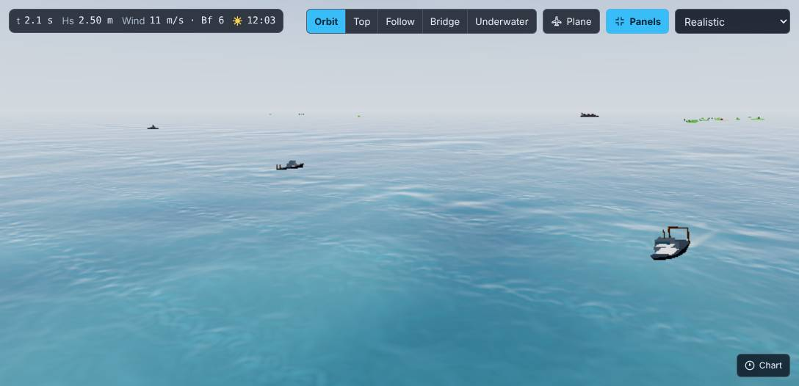
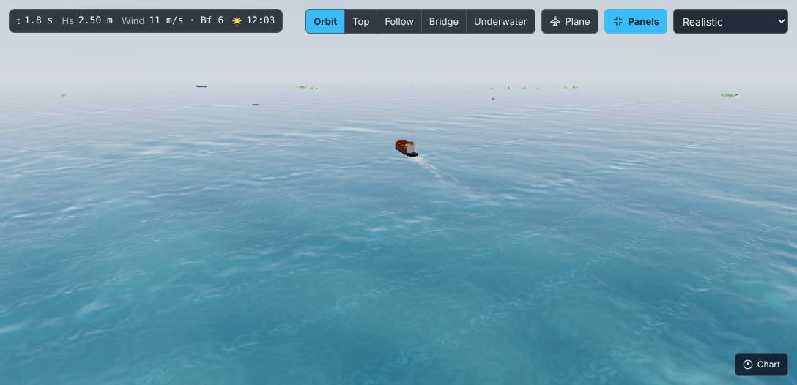
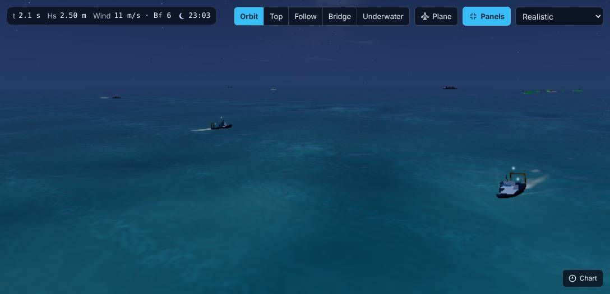
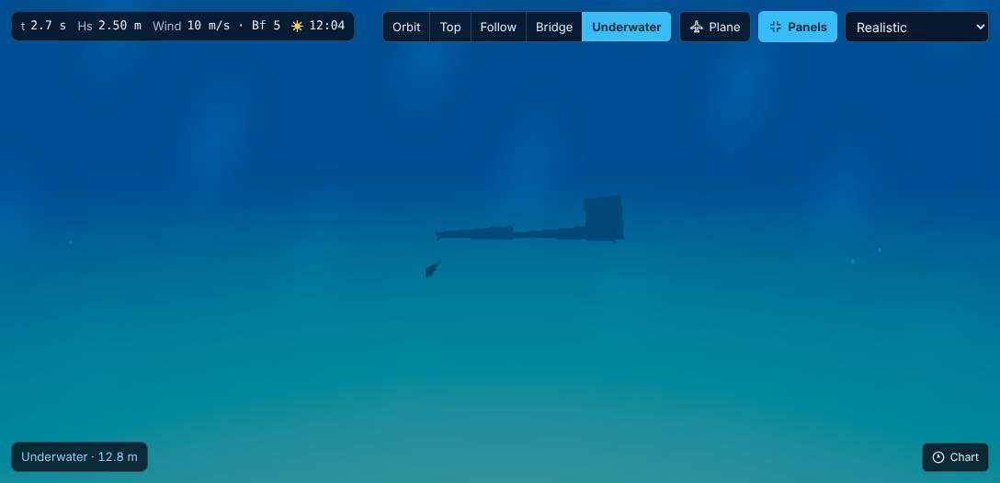

# Ambient World & Underwater Scenery (`#43`)

Wave Laboratory populates the horizon and underwater column with deterministic, seeded ambient layers that never perturb the wave field or vessel hydrostatics. Every layer is controlled by viewer preferences (`wave-lab:ambience`, edited in **Settings → Scenery**) and scaled by `SceneryTier` (`SceneryFrame.tier`), which the renderer resolves from the device-capped quality: `low` → `lite`, `medium` → `mid`, anything higher → `full`.

## Layers & Toggles

| Toggle (`AmbienceSettings`) | Default | Module                                                   | Contents                                                                                                                                                                                                                                                                          |
| --------------------------- | ------- | -------------------------------------------------------- | --------------------------------------------------------------------------------------------------------------------------------------------------------------------------------------------------------------------------------------------------------------------------------- |
| `islands`                   | `true`  | `src/render/scenery/islands.ts`                          | Procedural island & key chains on a 1.5 km grid outside `ISLAND_CLEAR_RADIUS` (450 m), with beaches, palms, huts, docks, and lighthouses.                                                                                                                                         |
| `traffic`                   | `true`  | `src/render/scenery/traffic.ts`                          | Working fishing fleets (2–3 stern trawlers circling grounds on a 1.8 km grid, hauling nets in rough weather), merchant cargo ships, cruise liners, VLCC oil tankers, patrol boats, and rare aircraft carriers with patrol escorts. Seen inside 5.2 km.                            |
| `structures`                | `true`  | `src/render/scenery/traffic.ts`                          | Hash-grid offshore oil platforms (derrick, helipad, persistent flare stack, flashing red beacon), wind-turbine arrays (static rotors), and cardinal sea buoys.                                                                                                                    |
| `underwater`                | `true`  | `src/render/underwater/scenery.ts` & `UnderwaterPass.ts` | Pooled open-water seabed with analytic wave-normal caustics, swaying kelp forests, coral clusters, sunken trawlers, the sunken Flight 19 TBM Avenger easter egg (`SUNKEN_AVENGER_SITE`), marine snow, night bioluminescence, and screen-space god-ray shafts from Snell's window. |
| `wildlife`                  | `true`  | `src/render/scenery/wildlife.ts` & `birds.ts`            | Dolphins bow-riding player and passerby ships, humpback whales, sea turtles, flying fish, and seabirds (gulls trailing working trawlers, plunge-diving terns, gliding albatrosses). Visible from below when submerged.                                                            |
| `sailors`                   | `true`  | `src/render/scenery/sailors.ts`                          | Procedural billboard crew walking decks and bridges in fair weather.                                                                                                                                                                                                              |
| `planes`                    | `true`  | `src/render/scenery/planes.ts`                           | Lost Bermuda Triangle flights (TBM Avengers, PBM Mariner, DC-3, C-54) with navigation lights and propeller discs.                                                                                                                                                                 |
| `hostiles`                  | `false` | `src/render/scenery/traffic.ts` & `planes.ts`            | Opt-in encounters: a square-rigged pirate lugger (`stepHostileEncounter`: `idle → approaching → paralleling → peeling`, hard despawn at 500 m) and low two-circle recon passes (`planReconPass`).                                                                                 |

## Tier Budgets

| Tier   | Resolved from                 | Max Traffic Hulls (`TRAFFIC_BUDGET`) | Max Structure Cells (`STRUCTURE_BUDGET`) | Max Underwater Draw Calls (`UNDERWATER_BUDGET`) |
| ------ | ----------------------------- | ------------------------------------ | ---------------------------------------- | ----------------------------------------------- |
| `full` | Quality `high` / `ultra`      | 12                                   | 3                                        | 4                                               |
| `mid`  | Quality `medium` (phones)     | 8                                    | 2                                        | 2                                               |
| `lite` | Quality `low` or software GPU | 4                                    | 0                                        | 1                                               |

Each cap lives in the module that enforces it (`render/scenery/traffic.ts`, `render/underwater/scenery.ts`).

## House Rules

1. **Zero physics feedback:** Scenery layers read `SceneryFrame` (`calm`, `daylight`, `hs`, `vessels`, `underwater`, `waterType`, `tier`) and export visual wake tracks (`WakeSource`) and wildlife anchors (`WildVessel`), never modifying `OceanField` or `Experiment`.
2. **Deterministic & Node-testable:** Placement, routing, weather gating, and encounter state machines are pure functions of `(ix, iy, t, calm, seed)` covered by Vitest unit tests (`traffic.test.ts`, `scenery.test.ts`, `islands.test.ts`, `wildlife.test.ts`, `birds.test.ts`, `planes.test.ts`).
3. **Instanced low-poly meshes:** Reuses parametric hulls (`src/vessel/hulls.ts`) and vertex-coloured procedural geometry with zero external textures or model assets. One `InstancedMesh` per hull class and per structure kind (10 meshes, empty ones skipped by the renderer, see "Draw calls"), plus one shared additive point pass for night lights.
4. **Deterministic routes, no teleporting:** a ship's pose is a pure function of its grid cell and the clock. `calm` only gates visibility and nets (it never rescales time), so dragging the weather slider cannot make ships jump. Routes stay inside their own 1.8 km cell, clear of the origin zone, islands and rigs; fishing fleets share one circle at even phase spacing, merchant lanes are racetracks with rounded ends, and heading is continuous round the ends (`traffic.test.ts`, "traffic route integrity").
5. **Budgets are tested against the real layers**, not just the constants: `src/render/scenery/budget.test.ts` counts hull instances and draw calls on `TrafficLayer` and `UnderwaterSceneryLayer` for all three tiers, and asserts zero underwater cost when surfaced or switched off.

## Draw calls

Traffic is one `InstancedMesh` per hull class (7: trawler, cargo, patrol, liner, tanker, carrier, pirate) and per structure kind (3: rig, turbine, buoy) plus one additive points pass for night lights. Empty instanced meshes are skipped by the renderer, so a frame draws only the classes actually in view: a typical frame is 3 to 6 calls, the worst case 11. The issue's "8+ ships at 2 extra draw calls" holds when the ships share two or three classes (a fleet of trawlers plus one lane ship), but not in general.

## Default: fair-weather, quiet sea?

The issue's definition of done asks that "defaults stay a fair-weather, quiet sea". Today every family except `hostiles` ships **on** by default, including `traffic`, `structures` and `underwater`. Hostiles (pirates, recon passes) are off by default, which is the part of the plan that makes the sea less quiet. Trade-off for a decision:

- **Keep `traffic: true`** (current): the horizon is alive from the first load, the feature is visible to everyone, and the cost is bounded by the tier caps (at most 12 / 8 / 4 hulls). Ships are far away (the origin clear zone is about 630 m) and never reach the player's vessel.
- **Default `traffic: false`**: matches the issue wording literally and keeps the first-run scene minimal, but most users would never discover the feature or the wakes and wildlife it feeds (bow-riding dolphins, trailing gulls).

The default has not been changed; the setting is one line in `DEFAULT_AMBIENCE` (`src/render/scenery/types.ts`) plus the persisted-settings e2e expectation.

## Screenshots

| Traffic fleets by day                                                       | Merchant lane by day                                                               |
| --------------------------------------------------------------------------- | ---------------------------------------------------------------------------------- |
|  |  |

| Navigation lights at night                                                                  | Underwater seabed with the sunken Avenger                                                    |
| ------------------------------------------------------------------------------------------- | -------------------------------------------------------------------------------------------- |
|  |  |
